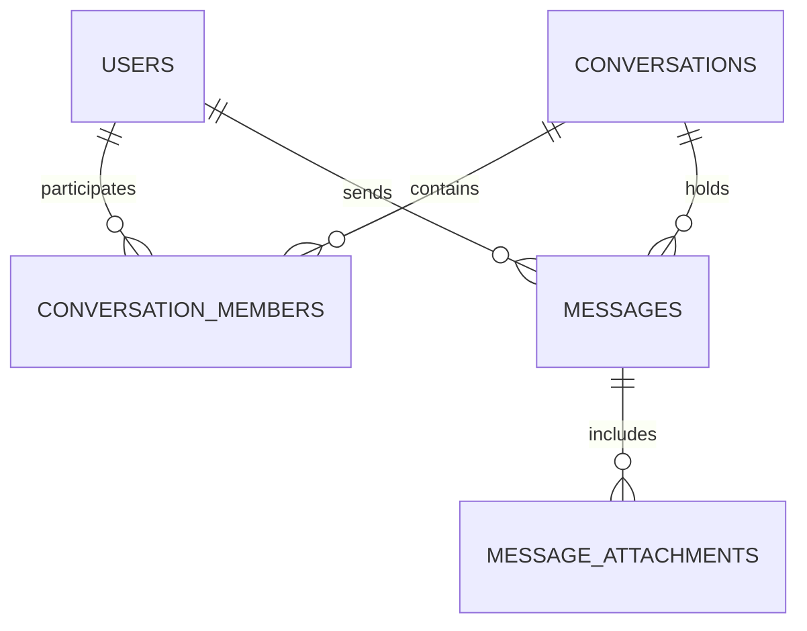

# ChatNet Data Architecture

## Tóm tắt

PostgreSQL giữ bản ghi có thẩm quyền, Redis phục vụ trạng thái ngắn hạn và realtime, object storage giữ blob media. Sơ đồ dưới đây chỉ biểu diễn quan hệ dữ liệu lõi được thấy trong schema.

## 1. Purpose

This document describes the durable and ephemeral data stores identified in the source baseline and their principal responsibilities. Detailed table and migration information is in the backend database documents.

## 2. Data-store responsibilities

| Store | Role | Data class |
|---|---|---|
| PostgreSQL | Primary durable relational store | Accounts, sessions, conversations, messages, social graph, feed, calls, marketplace and related metadata |
| Redis | Ephemeral/realtime coordination | Presence, event fanout, cache, rate limits and short-lived coordination as implemented by shared packages |
| S3-compatible object storage | Media object storage | Uploaded image, video, audio and file objects |
| Client storage | Local application state | Session-related state, drafts/outbox and cached UI state subject to platform-specific storage limitations |
| LiveKit | Real-time media plane | Call room and media session state, not the ChatNet relational system of record |

## 3. Relational domains

The base schema file contains 30 CREATE TABLE statements. Incremental migrations add or alter further structures.

| Domain | Tables in base schema |
|---|---|
| Identity and sessions | users, auth_sessions |
| Conversation and membership | conversations, conversation_members |
| Social graph and safety | friend_connections, user_blocks, user_reports, friend_request_events, friend_contact_metadata |
| Messaging and attachments | messages, message_reactions, message_attachments |
| Feed and moderation | posts, post_mentions, saved_posts, feed_reports, feed_moderators, post_attachments, stories, post_likes, comments |
| User preferences and translation | user_preferences, message_translations |
| Push | push_subscriptions |
| Calls | call_sessions, call_participants |
| Marketplace | market_products, market_cart_items, market_orders, market_order_items |

## 4. Relationship patterns

- Users own sessions, preferences, profile and social relationships.
- Conversations have members; messages belong to conversations and may reference earlier messages.
- Message reactions and attachments reference messages.
- Posts own attachments, comments, reactions, mentions and saved-post relationships.
- Stories and feed reports are associated with users and their respective content.
- Calls own participants; participants reference users and call sessions.
- Marketplace products reference sellers; cart rows reference buyers and products; orders reference buyers and sellers; order items reference orders and products.

Foreign keys and ON DELETE behavior in schema.sql are the source of truth. This summary is not a substitute for reviewing the actual schema before a migration.

## Quan hệ khóa ngoại của lõi chat

Mô hình rút gọn, không biểu diễn mọi khóa và quy tắc xóa. Đối chiếu các bảng trong [schema nguồn](../../backend/internal/database/schema.sql).

## 5. Redis and ephemeral state

The shared redisx and ratelimit packages provide Redis access and rate-limiting primitives. The Chat service uses Redis for presence/realtime-related behavior. Ephemeral state MUST NOT replace durable authorization records such as user identity, group membership or block policy.

The exact key naming, TTLs and event payloads need a dedicated source-level inventory before they are treated as a stable external contract.

## 6. Media data lifecycle

The current media integration uses a private S3-compatible object-store adapter, presigned upload operations, relay handling and authenticated media retrieval. Access tickets have bounded lifetime; already-issued signed URLs and bytes already transferred cannot be retroactively recalled. See [Media access control](../06-security/MEDIA_ACCESS_CONTROL.md).

Distributed peer storage, erasure coding, storage-node placement and paid recovery remain proposals only. They are not represented as current tables or production flows.

## 7. Data protection requirements

1. Do not store secrets or provider credentials in relational business tables.
2. Keep media buckets private and avoid public ACLs.
3. Restrict access to personal data and message metadata to the minimum required role and purpose.
4. Define retention and deletion policies for each domain before production claims are made.
5. Treat backups, replicas and object-store versions as data copies subject to the same privacy and recovery policy.
6. Do not claim E2EE for data stored in plaintext or merely relayed by the backend.

## 8. Open data architecture decisions

- Approved data retention and account deletion policy.
- Backup frequency, RPO, RTO and restore verification.
- Redis persistence and recovery objectives.
- Object lifecycle, versioning and deletion evidence.
- E2EE ciphertext and key-package lifecycle for multi-device/group use.
- Financial ledger design before Point/Coin or real-money features.
- Schema migration tracking/rollback policy beyond the current embedded sequence.

## 9. Related documents

- [Database schema](../04-backend/DATABASE_SCHEMA.md)
- [Database migrations](../04-backend/DATABASE_MIGRATIONS.md)
- [Media storage](../04-backend/MEDIA_STORAGE.md)
- [Security overview](../06-security/SECURITY_OVERVIEW.md)

## Lịch sử thay đổi

- 1.0.0 (2026-11-19) — Chuẩn hóa nội dung và đối chiếu baseline.
