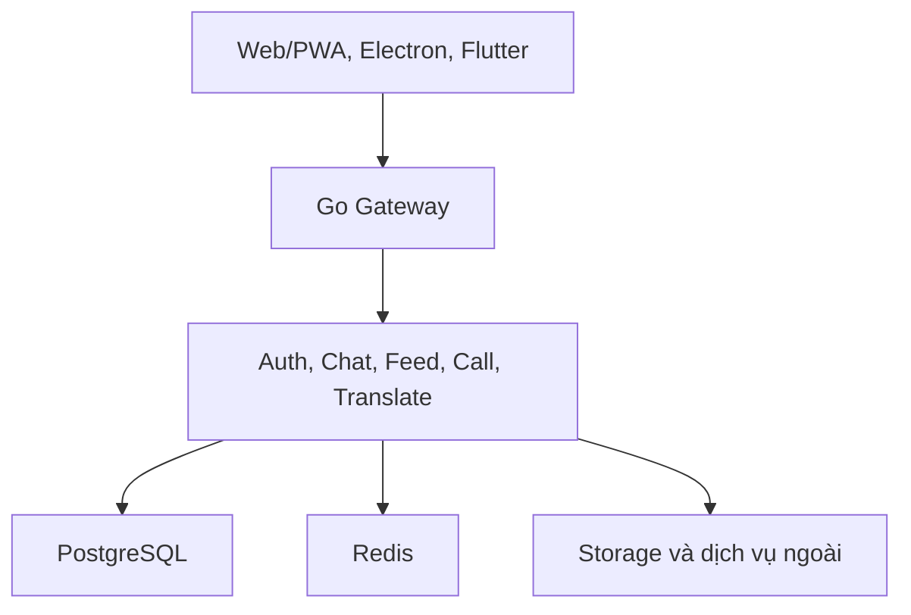

# ChatNet System Context

## Tóm tắt

Người dùng có ba cách tiếp cận từ source. ChatNet kiểm quyền ở service dù request được định tuyến qua Gateway. LiveKit, storage, email, push và AI là ranh giới ngoài cần kiểm riêng theo môi trường.

## 1. Purpose

This document describes the system context, external actors, adjacent systems and major trust boundaries for ChatNet. It is the context viewpoint of the architecture description.

## 2. System boundary

ChatNet is the application system consisting of Web/PWA, Electron Desktop, Flutter client source, a Go API gateway, Auth, Chat, Feed, Call and Translation services, PostgreSQL, Redis and configured external integrations.

External systems are not part of the ChatNet source repository. Their availability, contracts and configuration must be verified per environment.

## 3. Context view

End users interact through Web/PWA, Electron Desktop or the Flutter client source. These clients call the HTTPS API Gateway. The Gateway routes requests to Auth, Chat, Feed, Call and Translation services.

The services use PostgreSQL for durable records, Redis for realtime and ephemeral coordination, and S3-compatible object storage for media. The Call service integrates with LiveKit. Push uses OneSignal. Registration uses a configured email provider. Translation uses a server-configured AI provider.

## Ranh giới triển khai và phụ thuộc

Sơ đồ thể hiện API và phụ thuộc từ source. Media trên trình duyệt có thể đi trực tiếp tới object storage hoặc LiveKit theo quyền được backend cấp, không nhất thiết qua Gateway. Đối chiếu [Gateway](../../backend/cmd/gateway/main.go), [runner](../../backend-run.sh) và [deployment view](DEPLOYMENT_ARCHITECTURE.md).

## 4. External actors and systems

| Actor / system | Interaction with ChatNet | Trust consideration |
|---|---|---|
| Visitor | Registration and public/unauthenticated surfaces | Untrusted input; registration abuse controls apply |
| Authenticated user | Messaging, social, calls, profile and settings | Identity is session-bound; authorization remains server-side |
| Group owner / moderator | Membership, governance and moderation | Role and membership must be checked for each protected action |
| Web browser | Loads SPA/PWA and invokes API | Browser storage and client state are not trusted authorities |
| Electron host OS | Notifications, media permission, screen capture and secure storage | Native operations must be restricted to trusted IPC frames |
| Flutter runtime | Mobile client API and platform capabilities | Source exists; supported release platforms need separate confirmation |
| PostgreSQL | Durable application records | Credentials and network access are environment-controlled |
| Redis | Realtime/presence and ephemeral coordination | TTL state is not a durable authorization source |
| S3-compatible storage | Media upload/download | Bucket must remain private; presigned URL lifetime and revocation are bounded |
| LiveKit | Real-time audio/video rooms | Server-issued credentials and room authorization are required |
| OneSignal | Push notification delivery | App ID and REST credentials are external configuration |
| Email provider | Registration and verification messages | Provider failure and rate limits affect registration |
| AI provider | Text/UI translation and call translation | Provider keys remain server-side; audio processing requires consent |

## 5. Principal data flows

1. Clients authenticate through the Auth service via the gateway.
2. Clients send messaging, identity, contact, privacy, media and realtime requests to the Chat service.
3. Feed operations, stories, moderation and marketplace operations route to Feed.
4. Call lifecycle and translation-session operations route to Call; media transport uses LiveKit.
5. Text/UI translation requests route to Translation, which reads provider configuration on the server.
6. Services use PostgreSQL for durable records and Redis for configured ephemeral/realtime behavior.
7. Media uses a private S3-compatible object store through scoped capabilities and backend authorization paths.
8. Push and email delivery are performed through configured external providers.

## 6. Trust boundaries

- Browser/renderer to API: all input is untrusted; server validates authentication, authorization, size, format and policy.
- Electron renderer to Main: IPC is a privileged boundary; Main verifies trusted frame and operation scope.
- ChatNet backend to external providers: credentials are server-only and provider failure must fail safely.
- Backend to object storage: bucket/object policy and signed URL scope are security-critical.
- MLS pilot: the server relays protocol state but the current feature is experimental; do not infer production end-to-end confidentiality from the presence of MLS code.

## 7. Out-of-boundary proposals

Distributed peer storage, paid media recovery, Point/Coin ledger operations and AI-first marketplace seller workflows are not established as implemented by this baseline. They are documented as proposals or product specifications and are not part of the current operational system boundary.

## 8. Related views

- [System architecture](SYSTEM_ARCHITECTURE.md)
- [Deployment architecture](DEPLOYMENT_ARCHITECTURE.md)
- [Data architecture](DATA_ARCHITECTURE.md)
- [Security overview](../06-security/SECURITY_OVERVIEW.md)

## Lịch sử thay đổi

- 1.0.0 (2026-11-19) — Chuẩn hóa nội dung và đối chiếu baseline.
